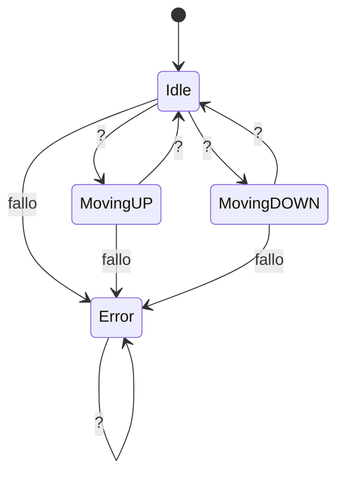

# Examen Máquina de Estados

## Tipo de variables (20 puntos)
- Elige adecuadamente el tipo de variables conforme las explicaciones de clase
- Utiliza variedad de tipos con configuraciones completas y adecuadas a la situación
> Primero hago el apartado de la botonera interior donde indica a cual de los dos pisos quiero ir 

## Estados (20 puntos)
- Implementa los estados teniendo en cuenta las indicaciones de clase
- Utiliza varias funciones dentro de los estados para realizar las acciones necesarias
> hago una clase HaloDeVigo que me define los estados en los que puede estar el ascensor, creo esto con un singleton y le pongo los 4 estados que me pide el ejercicio. Despues hago la clase Nivel donde me define los valores que tiene cada nivel y los guardo en la variable llamada nivel_actual

## Transiciones (20 puntos)
- Decide las transiciones entre estados
- Las utiliza para decidir como la máquina cambia de estados utilizando sintaxis dadas en clase
> Hago una clase de HaloEstados donde defino las transiciones entre los estados

## Test (20 puntos)
- Realiza un número extenso de test unitarios para comprobar el funcionamiento de la máquina de estados.
> Unos test para comprobar que me funcone los gestores de estados

## Diagrama de estados

> Basicamente el ascensor siempre estara en un estado de IDLE hasta que reciba la orden de que nivel quiere subir o bajar, una vez indicado que nivel es se cerraran la spuertas y se subira o se bajara, el ascensor tambien dara error si el usuario presiona el mismo boton del nivel al que quiere subir cuando ya esta en ese mismo nivel, ahi el ascensor abrira las puertas y volvera al estado de idle.